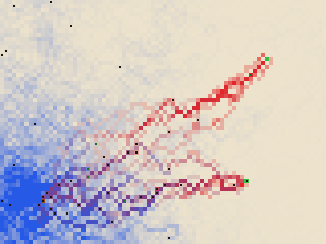
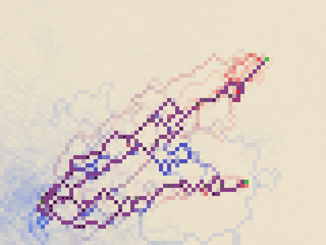
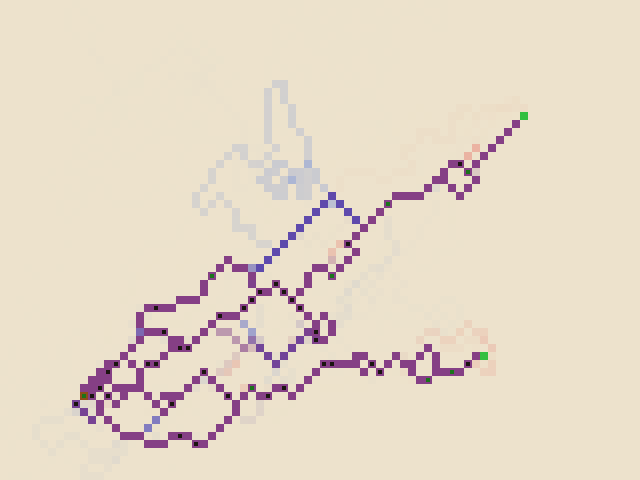
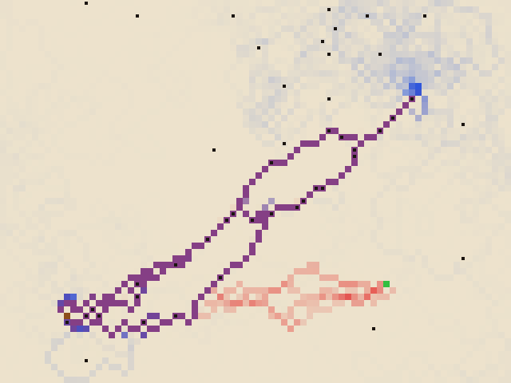

# Cenário C1 — ambiente estático

Verificação da formação e da estabilização da trilha de feromônio no ambiente estático,
encerrando a versão preliminar da simulação (incrementos 1 a 3).

## Configuração

| Item | Valor |
|---|---|
| Grade | 80 × 60 células, sem obstáculos |
| Ninho | (10, 10) |
| Fontes de alimento | (65, 45) e (60, 15), 500 unidades cada |
| Formigas | 50 |
| Período do ciclo da formiga | 50 ms |
| Depósito de feromônio | 10 por célula, multiplicado por 0,99 a cada passo desde a origem |
| Influência do feromônio (α) | 2 |
| Evaporação | 0,5% a cada 100 ms |
| Duração | 180 s por execução |
| Sementes | 1, 2 e 3 |

Métricas coletadas a cada 5 s (arquivos `metricas_semente*.csv`):

- `entregue`: alimento acumulado no ninho;
- `intervalo`: alimento entregue nos últimos 5 s;
- `celulasTrilha`: células com feromônio de alimento ≥ 5;
- `formigasNaTrilha`: formigas sobre essas células;
- `carregando`: formigas carregando alimento;
- `alimentoRestante`: soma do alimento nas fontes.

Nas capturas, azul é feromônio de ninho, vermelho é feromônio de alimento e roxo é a
sobreposição dos dois; o ninho é marrom, as fontes são verdes, as formigas são pontos escuros
(verde-escuro quando carregam alimento).

## Resultados

| t (s) | Entregue (s1 / s2 / s3) | Células de trilha (s1 / s2 / s3) | Formigas na trilha (s1 / s2 / s3) |
|---:|---|---|---|
| 30 | 14 / 20 / 40 | 479 / 504 / 378 | 34 / 41 / 45 |
| 60 | 113 / 124 / 133 | 364 / 240 / 235 | 50 / 48 / 48 |
| 90 | 206 / 246 / 233 | 239 / 181 / 181 | 50 / 48 / 49 |
| 120 | 301 / 367 / 337 | 235 / 157 / 147 | 50 / 49 / 47 |
| 150 | 391 / 488 / 446 | 211 / 152 / 138 | 49 / 50 / 49 |
| 180 | 458 / 517 / 514 | 217 / 219 / 267 | 50 / 31 / 31 |

## Observações

1. **Exploração inicial (0–30 s).** As formigas saem do ninho em todas as direções, deixando um
   campo difuso de feromônio de ninho. As primeiras entregas no ninho ocorrem entre 15 e 20 s.
   

2. **Formação da trilha (30–60 s).** As formigas que voltam com alimento deixam feromônio de
   alimento; as que estão procurando passam a segui-lo e reforçam o caminho. Nesse período há
   muitos caminhos paralelos (até ~500 células marcadas), e o número de formigas sobre a trilha
   sobe de ~35 para praticamente todas (48–50 de 50).
   

3. **Estabilização (a partir de ~90 s).** Os caminhos menos usados evaporam e a trilha se
   concentra em poucas rotas estreitas: a área marcada cai para 140–240 células e se mantém
   nessa faixa. A taxa de entrega fica aproximadamente constante, entre 10 e 25 unidades a cada
   5 s (cerca de 3 a 4 por segundo). As trilhas de ida e volta coincidem (cor roxa), indicando
   o uso da mesma rota nos dois sentidos.
   

4. **Uso das fontes.** Na semente 1, as duas fontes ficaram ligadas ao ninho por trilhas ao
   mesmo tempo. Nas sementes 2 e 3, a colônia concentrou-se principalmente em uma das fontes,
   reforçando-a até o esgotamento (semente 2: fonte superior; semente 3: fonte inferior).

5. **Esgotamento de uma fonte.** Nas sementes 2 e 3, a fonte mais explorada se esgotou por volta
   de 160 s (semente 2) e 165 s (semente 3). A entrega caiu para quase zero, o feromônio da trilha antiga começou a
   evaporar e as formigas se espalharam em torno do local vazio (nuvem azul na captura abaixo),
   reduzindo as formigas na trilha de ~49 para ~31. Na semente 2 ainda havia uma trilha fraca até
   a outra fonte; na semente 3 a outra fonte nunca chegou a ter trilha. Em nenhum dos casos houve
   migração para a fonte restante dentro dos 180 s. Esse comportamento é o
   ponto de partida para os cenários dinâmicos (remoção de fonte, C3).
   

6. **Variação entre execuções.** Como cada formiga é executada em sua própria thread no JADE,
   a ordem de execução varia e a mesma semente não reproduz exatamente os mesmos números; o
   comportamento qualitativo (formação, estreitamento e estabilização da trilha) se repetiu nas
   três sementes.

## Ajustes feitos durante a verificação

- **Evaporação.** Com 2% a cada 100 ms, a trilha evaporava mais rápido do que era reforçada e
  não chegava a se estabilizar (até 30 células marcadas, entrega de ~0,3/s). Com 0,5% a trilha
  se mantém.
- **Persistência de direção.** Sem preferência por seguir em frente, as formigas ficavam presas
  em pequenos laços entre células com muito feromônio. Ponderar a escolha pelo alinhamento com o
  rumo atual (e, no retorno, com a direção do ninho) eliminou os laços e aumentou a entrega de
  ~0,3/s para ~3,5/s.
